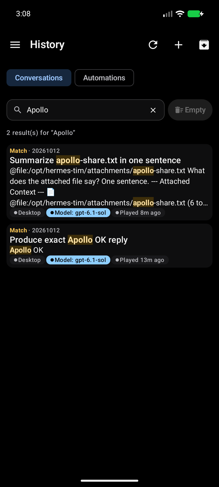
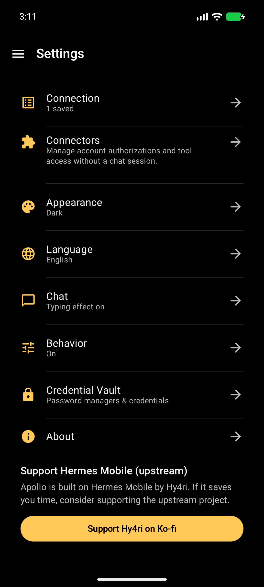

<h1 align="center">Apollo</h1>
<p align="center"><strong>A native Android client for <a href="https://github.com/NousResearch/hermes-agent">Hermes Agent</a>.</strong><br>
Your agent keeps running on your own computer. Apollo is the remote control in your pocket.</p>

<p align="center">
  
  
  
</p>

> Apollo is an independent, community-built client. It is **not** affiliated
> with or endorsed by Nous Research. It is a fork of
> [Hermes Mobile](https://github.com/Hy4ri/hermes-mobile) by Hy4ri. See
> [UPSTREAM.md](UPSTREAM.md) and [NOTICE](NOTICE).

## Screenshots

<p align="center">
  
  
  
  
</p>

## Features

- **Chat:** live streaming replies, Markdown with syntax highlighting, code
  copy, tool calls and their results, reasoning, inline images and media,
  stop/interrupt, steer, branch and compress sessions, and slash commands.
- **Approvals and questions:** tool approvals, clarify questions, sudo,
  secret and vault prompts, answered in the chat or from a notification.
- **Sessions and projects:** browse, search, pin, resume and manage sessions.
  Group sessions by project and start new chats inside a project. After a
  dropped connection Apollo replays missed events and parked approvals; it
  never closes server sessions, so other clients keep their runs.
- **Files:** attach images, PDFs and other files, or **share them into Apollo
  from any app** through the Android share sheet. Browse and download files
  on the host, and open agent-generated files.
- **Automation:** cron jobs, Kanban boards and tasks, webhooks.
- **Agent management:** models and providers, profiles, skills, MCP servers,
  plugins, toolsets, environment keys, config, live logs, processes, gateway
  and channel status, usage and token analytics.
- **Android integration:** notifications for finished tasks and pending
  approvals with inline reply, an optional background connection (foreground
  service), dictation and read-aloud through Hermes' audio endpoints, and the
  digital-assistant role.
- **Large screens and keyboards:** wide layouts keep the chat readable on
  tablets and foldables; Ctrl+Enter sends from a hardware keyboard.
- **Look and language:** true-black AMOLED dark theme by default, an optional
  light mode, Material You and six more themes. English and German follow
  the system language, with a manual switch in Settings (plus Arabic,
  Chinese, Italian, Korean and Spanish from upstream).
- **Privacy:** no telemetry, ads or trackers. Credentials live in encrypted
  storage backed by the Android Keystore. The only outbound request besides
  your Hermes server is the optional GitHub release check.

## Install

Download the APK from the
[latest release](https://github.com/wutz-io/apollo-hermes-android/releases/latest)
and open it on your phone. Until signed releases are published, use the debug
APK from the latest successful
[CI run](https://github.com/wutz-io/apollo-hermes-android/actions/workflows/android.yml)
(artifact `apollo-debug-apk`) or build it yourself (see [BUILD.md](BUILD.md)).

## Connect over Tailscale (recommended)

Hermes keeps running on your computer. Apollo talks to the official Hermes
dashboard API (`hermes dashboard` or the headless `hermes serve`, default
port 9119). Tailscale Serve provides tailnet-only HTTPS with a valid
certificate, so you need no open ports and no public exposure.

1. **Choose a dashboard login.** A proxied, non-loopback origin always requires
   a Hermes auth provider. Add a username and password to
   `~/.hermes/config.yaml`:

   ```yaml
   dashboard:
     public_url: "https://<machine>.<tailnet>.ts.net"
     basic_auth:
       username: <your-user>
       # Preferred: store only a hash. Compute it from the hermes-agent checkout:
       #   python -c "from plugins.dashboard_auth.basic import hash_password; print(hash_password('PW'))"
       password_hash: "scrypt$…"
       secret: "<output of: openssl rand -base64 32>"  # keeps sessions valid across restarts
   ```

2. **Run the backend on loopback only:**

   ```bash
   hermes serve --host 127.0.0.1 --port 9119
   ```

3. **Expose it to your tailnet over HTTPS:**

   ```bash
   tailscale serve --bg 9119
   ```

4. **In Apollo**, tap **Sign in**, enter `https://<machine>.<tailnet>.ts.net`,
   and log in with the username and password. Apollo detects the auth mode,
   stores the session in encrypted storage and reconnects automatically.

`dashboard.public_url` must match the HTTPS origin exactly. Without it, Hermes
rejects proxied requests with `400 Invalid Host header` (its DNS-rebinding
guard). TLS certificates are always verified. Apollo never disables
certificate checks.

Other setups are covered in the
[connection reference](docs/connection-reference.md): loopback token, LAN with
basic auth, mTLS client certificates, private CAs, Cloudflare Access headers,
and multiple servers. Plain `http://` works for trusted networks only.

## Security notes

- Apollo controls an agent with access to your computer. Keep the dashboard
  bound to `127.0.0.1` and reach it only through Tailscale (or another
  authenticated tunnel).
- Destructive actions (deleting sessions, profiles, jobs, restoring backups,
  killing processes) ask for confirmation. Tool approvals show the full
  command before you allow it.
- Apollo runs no backend, cloud relay or push service of its own.
  Notifications come from the app's own connection to your server.

## Development

- [BUILD.md](BUILD.md): build, test, versioning, release signing
- [AGENTS.md](AGENTS.md): rules for (AI) contributors
- [docs/ARCHITECTURE.md](docs/ARCHITECTURE.md): architecture conventions inherited from upstream
- [DESIGN.md](DESIGN.md): visual and interaction requirements
- [UPSTREAM.md](UPSTREAM.md): fork point and how to merge upstream changes
- [CHANGELOG.md](CHANGELOG.md)

## License

Apache License 2.0, see [LICENSE](LICENSE) and [NOTICE](NOTICE).
Copyright 2026 M57 (Hy4ri) and contributors (Hermes Mobile).
Apollo modifications copyright 2026 wutz.io.
