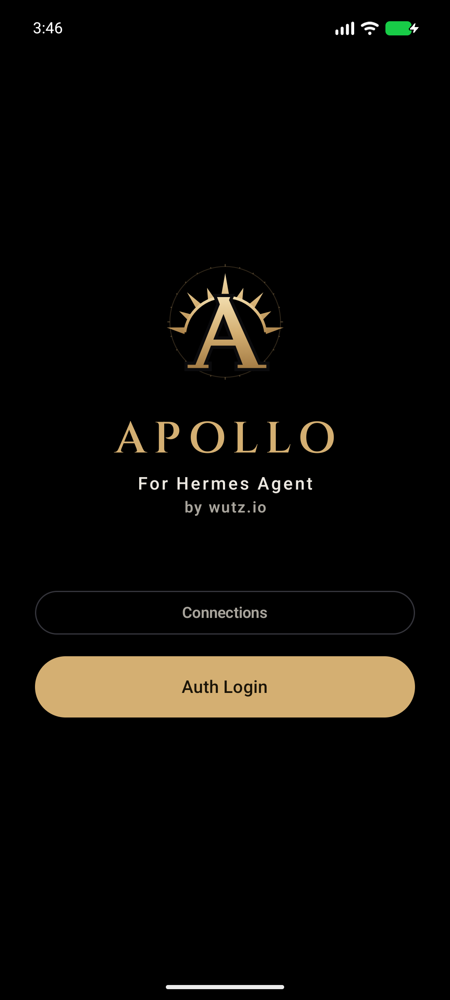
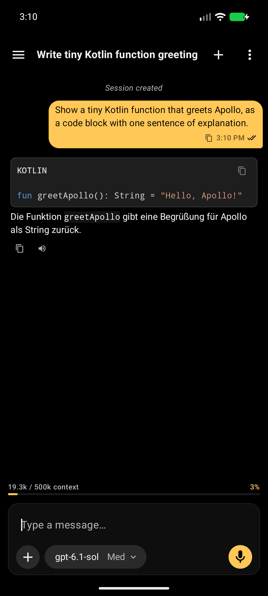
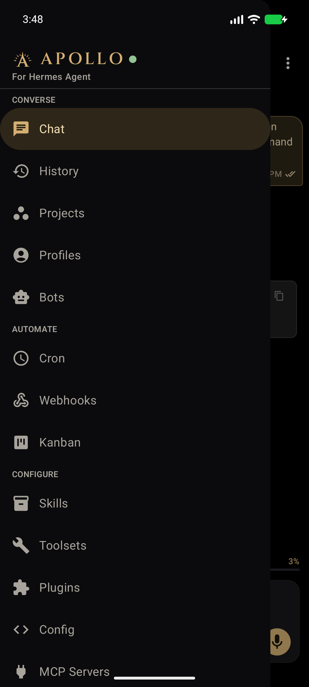
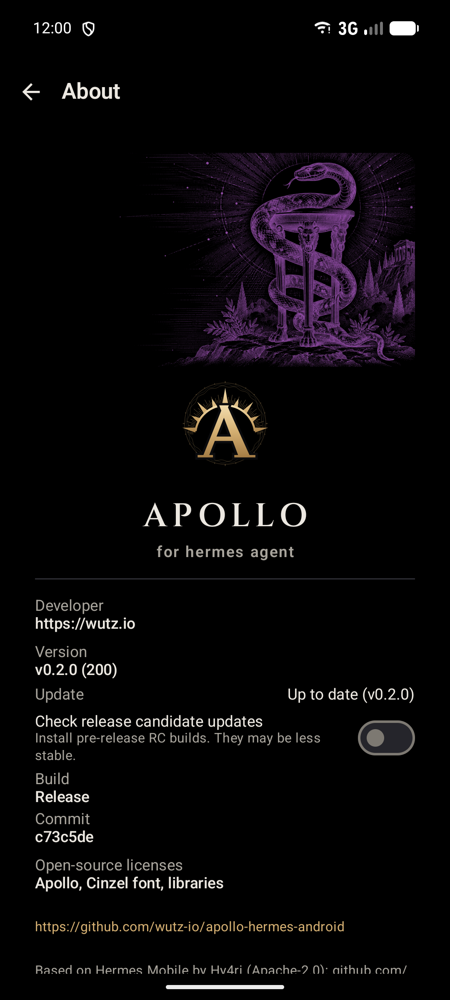

<p align="center"></p>

<p align="center"><strong>A native Android client for <a href="https://github.com/NousResearch/hermes-agent">Hermes Agent</a>, by <a href="https://wutz.io">wutz.io</a>.</strong><br>
Your agent keeps running on your own computer. Apollo is the remote control in your pocket.</p>

<p align="center">
  
  
  
</p>

> Apollo is an independent open-source Android client for Hermes Agent, developed by wutz.io. Not affiliated with or endorsed by Nous Research.
>
> Apollo started as a fork of [Hermes Mobile](https://github.com/Hy4ri/hermes-mobile) by Hy4ri
> and has been developed independently since 2026-10-13. See [ORIGIN.md](ORIGIN.md) and
> [NOTICE](NOTICE).

## Screenshots

<p align="center">
  
  
  
  
</p>

## Features

- **Chat:** live streaming replies, Markdown with syntax highlighting, code
  copy, tool calls and their results, reasoning, inline images and media,
  stop/interrupt, steer, branch and compress sessions, and slash commands.
- **Approvals and questions:** tool approvals, clarify questions, sudo,
  secret and vault prompts, answered in the chat or from a notification.
- **Sessions and projects:** browse, search, pin, resume and manage sessions.
  Group sessions by project and start new chats inside a project. After a
  dropped connection Apollo replays missed events and parked approvals; it
  never closes server sessions, so other clients keep their runs.
- **Files:** attach images, PDFs and other files, or **share them into Apollo
  from any app** through the Android share sheet. Browse and download files
  on the host, and open agent-generated files.
- **Automation:** cron jobs, Kanban boards and tasks, webhooks.
- **Agent management:** models and providers, profiles, skills, MCP servers,
  plugins, toolsets, environment keys, config, live logs, processes, gateway
  and channel status, usage and token analytics.
- **Android integration:** notifications for finished tasks and pending
  approvals with inline reply, an optional background connection (foreground
  service), dictation and read-aloud through Hermes' audio endpoints, a
  hands-free **voice conversation** in the chat (it listens, sends what you
  say, speaks the reply while it streams, and stops talking when you
  interrupt), and the digital-assistant role.
- **Large screens and keyboards:** wide layouts keep the chat readable on
  tablets and foldables; Ctrl+Enter sends from a hardware keyboard.
- **Look and language:** the Apollo design system (true-black AMOLED dark by
  default, antique gold accents, classical display type and purple engraving
  illustrations; see [docs/BRANDING.md](docs/BRANDING.md)), an optional light
  mode, Material You
  and seven further themes. English and German follow
  the system language, with a manual switch in Settings (plus partial
  Arabic, Chinese, Italian, Korean and Spanish from Hermes Mobile; newer
  strings fall back to English).
- **Privacy:** no telemetry, ads or trackers. Credentials live in encrypted
  storage backed by the Android Keystore. The only outbound request besides
  your Hermes server is the optional GitHub release check (the Google Play
  build has no self-updater and makes no such request).

## Requirements and compatibility

- Android 8.0 (API 26) or newer, on phones, tablets and foldables.
- Hermes Agent with the dashboard API (`hermes serve`). Apollo is tested with
  Hermes Agent v0.21.6. Its gateway calls are checked against the contract of
  hermes-agent `ea114c3` (2026-09-29). Newer Hermes releases are expected to
  work but are not tested with every Apollo release.
- Tailscale on the computer and the phone for the recommended setup.

## Install

Download the APK from the
[latest release](https://github.com/wutz-io/apollo-hermes-android/releases/latest)
and open it on your phone. Releases are signed with the Apollo release key;
updates install over the previous version. To build it yourself, see
[BUILD.md](BUILD.md).

### Verify the download

Check the signing certificate before you install it (`apksigner` is part of
the Android SDK build-tools):

```bash
apksigner verify --print-certs apollo-v<version>.apk | grep SHA-256
```

The SHA-256 digest must be

```text
f6ff6e51356e8aa37eb23a518dee62691fad0a1eebb9c68298a0d0bc9880fb3e
```

(`CN=Apollo, O=wutz.io, C=DE`). Android also refuses an update signed with a
different key.

## Connect over Tailscale (recommended)

Hermes keeps running on your computer. Apollo talks to the official Hermes
backend (`hermes serve`, the headless dashboard API). Tailscale Serve adds
tailnet-only HTTPS with a valid certificate, so you need no open ports and no
public exposure. You need Hermes Agent and Tailscale on the computer, and
Tailscale on the phone.

### Quick setup (Linux with systemd)

On the computer that runs Hermes:

```bash
curl -fsSLO https://raw.githubusercontent.com/wutz-io/apollo-hermes-android/main/scripts/server/setup-hermes-for-apollo.sh
less setup-hermes-for-apollo.sh        # read it first; it only touches your user account
bash setup-hermes-for-apollo.sh        # asks for a password for the Apollo login
sudo tailscale serve --bg 9119         # the one command the script prints at the end
```

The script:

- creates a login (only a scrypt hash is stored);
- writes it with your Tailscale HTTPS address to `~/.config/apollo/hermes-serve.env`
  (mode 600, `config.yaml` stays untouched);
- installs the systemd user service `hermes-serve` on `127.0.0.1:9119`;
- checks that the login is enforced and foreign host names are rejected.

Run it again at any time; it keeps the login unless you pass `--new-login`.
Options: `--generate-password`, `--port`, `--public-url`, `--no-service` (prints
the command to run Hermes yourself, e.g. on systems without systemd) and
`--uninstall`. See `--help`.

Then, in Apollo: tap **Sign in**, enter `https://<machine>.<tailnet>.ts.net` and
log in. Apollo detects the auth mode, stores the session in encrypted storage
and reconnects automatically.

To keep the service running while you are logged out, enable lingering once:
`loginctl enable-linger $USER`.

### Manual setup

The script only uses documented Hermes settings. You can set them yourself as
environment variables for `hermes serve --host 127.0.0.1 --port 9119`, or in the
`dashboard:` section of `config.yaml`:

| Environment variable | `config.yaml` |
| --- | --- |
| `HERMES_DASHBOARD_PUBLIC_URL=https://<machine>.<tailnet>.ts.net` | `dashboard.public_url` |
| `HERMES_DASHBOARD_BASIC_AUTH_USERNAME` | `dashboard.basic_auth.username` |
| `HERMES_DASHBOARD_BASIC_AUTH_PASSWORD_HASH` (`scrypt$16384$8$1$<salt>$<key>`) | `dashboard.basic_auth.password_hash` |
| `HERMES_DASHBOARD_BASIC_AUTH_SECRET` (32 random bytes, base64) | `dashboard.basic_auth.secret` |

`public_url` must match the HTTPS origin exactly. Without it, Hermes rejects
proxied requests with `400 Invalid Host header` (its DNS-rebinding guard), and
setting it always enables the login gate. TLS certificates are always
verified; Apollo never disables certificate checks.

Other setups are covered in the
[connection reference](docs/connection-reference.md): loopback token, browser
sign-in, mTLS client certificates, private CAs, Cloudflare Access headers,
and multiple servers. Plain `http://` works for trusted networks only.

### Troubleshooting

- **401 after a correct password:** `public_url` is missing or a loopback
  address, so Hermes' login gate is off. Set it to the HTTPS address you enter
  in Apollo and restart Hermes.
- **400 `Invalid Host header`:** `public_url` does not match the address you
  use. It must be the exact HTTPS origin.
- **Cannot reach the server:** check that Tailscale is connected on the phone
  and that `tailscale serve status` on the computer lists port 9119.
- More cases (client certificates, private CAs) are in the
  [connection reference](docs/connection-reference.md#troubleshooting).

## Security notes

- Apollo controls an agent with access to your computer. Keep the dashboard
  bound to `127.0.0.1` and reach it only through Tailscale (or another
  authenticated tunnel).
- Destructive actions (deleting sessions, profiles, jobs, restoring backups,
  killing processes) ask for confirmation. Tool approvals show the full
  command before you allow it.
- Apollo runs no backend, cloud relay or push service of its own.
  Notifications come from the app's own connection to your server.
- An optional app lock (Settings > Behavior > App lock, off by default) asks
  for your fingerprint, face or screen lock when Apollo opens and after it was
  in the background for a set time. Notification actions are not covered by it.

## Development

- [BUILD.md](BUILD.md): build, test, versioning, release signing
- [AGENTS.md](AGENTS.md): rules for (AI) contributors
- [docs/ARCHITECTURE.md](docs/ARCHITECTURE.md): architecture conventions (inherited from Hermes Mobile)
- [DESIGN.md](DESIGN.md): visual and interaction requirements
- [docs/BRANDING.md](docs/BRANDING.md): Apollo brand, colours, typography and assets
- [ORIGIN.md](ORIGIN.md): where Apollo comes from and what it changed
- [CHANGELOG.md](CHANGELOG.md)
- [SECURITY.md](SECURITY.md): how to report a vulnerability

## License

Apache License 2.0, see [LICENSE](LICENSE) and [NOTICE](NOTICE).
Copyright 2026 M57 (Hy4ri) and contributors (Hermes Mobile).
Apollo modifications, brand and artwork copyright 2026 wutz.io.
The Cinzel typeface is licensed under the SIL Open Font License 1.1
([docs/licenses/Cinzel-OFL.txt](docs/licenses/Cinzel-OFL.txt)).
