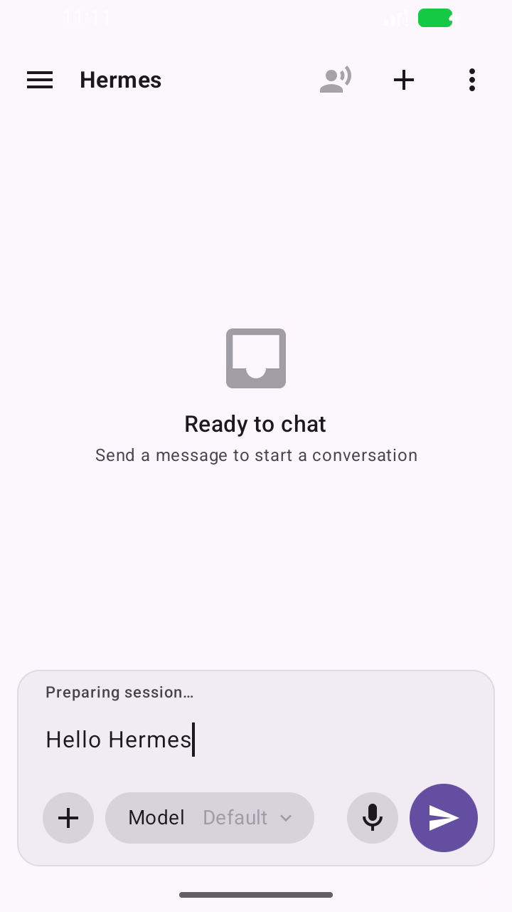

# PR #66: offline ChatScreen evidence

The session-context extraction in [PR #66](https://github.com/wutz-io/apollo-hermes-android/pull/66)
was tested from code commit `7405d23059544e7185b0b3815c5a93282c75fa55` on
2026-10-16. This follow-up adds documentation and real captures only.
The app, Gradle inputs, existing tests and PR checker are unchanged.
[The receipt](evidence.json) records their Git object IDs and the APK/media hashes.
The APK's generated `BuildConfig.GIT_SHA` is `7405d23`; a later evidence-commit
SHA does not imply that these APKs were rebuilt with different app code.

## Observed result

A fresh headless Android 17 / API 37 emulator, 720 x 1280 at 320 dpi, ran with
two cores, 2 GB RAM and software rendering. Wi-Fi and mobile data were disabled.
`assembleDebug assembleDebugAndroidTest` passed in 47 seconds. The existing
[ChatScreenTest](../../../app/src/androidTest/java/io/wutz/apollo/ui/chat/ChatScreenTest.kt)
ran on that emulator: **2 tests passed**, JUnit time 8.524 seconds.

- `chatScreen_renders_and_acceptsInput`: the mic is visible, the send button is
  initially absent, entering synthetic `Hello Hermes` makes send visible, and
  the mic remains visible.
- `chatScreen_sendButtonShownForAttachmentWithEmptyInput`: the input and send
  button are visible with a synthetic `content://test/photo.jpg` attachment.

The already-passed source gate is reused: **3,901 unit tests in 375 suites**,
zero failures/errors/skips, including eight session-context tests, plus the
repository's lint, resource, compile and permission checks. The complete gate
was not repeated for this evidence-only follow-up.

## Actual capture and limits

**No comparable before capture is available.** This is a candidate-only,
offline component test with a mocked `ChatViewModel` and synthetic state.
It does not exercise a live Hermes server or the extracted session-ownership
logic on a device; those ownership cases are covered by the JVM tests.
The existing Compose fixture uses default Material styling rather than the
full Apollo theme. Its `Hermes` title and light/purple appearance are fixture
output, not a branding or theme change. No English/German theme matrix,
physical device or live voice/session flow was checked here.

[Original unedited screen recording (9.87 seconds)](chat-screen-recording.mp4).
It includes the fresh emulator launcher and blank test-activity transitions.
The PNG is a full native-resolution frame decoded from that recording; it was
not cropped, retouched or reconstructed. Only synthetic test data appears.
The dedicated emulator and its private ADB server were stopped afterward.

This closes the missing-media requirement without changing the
[PR checker](../../../.github/scripts/check_pr_template.py). It does not complete
[issue #31](https://github.com/wutz-io/apollo-hermes-android/issues/31) or the
[full refactoring issue #65](https://github.com/wutz-io/apollo-hermes-android/issues/65).
History paging, send orchestration and per-method RPC-result routing remain
in `ChatViewModel`. Hosted CI Summary must pass before a future merge.
